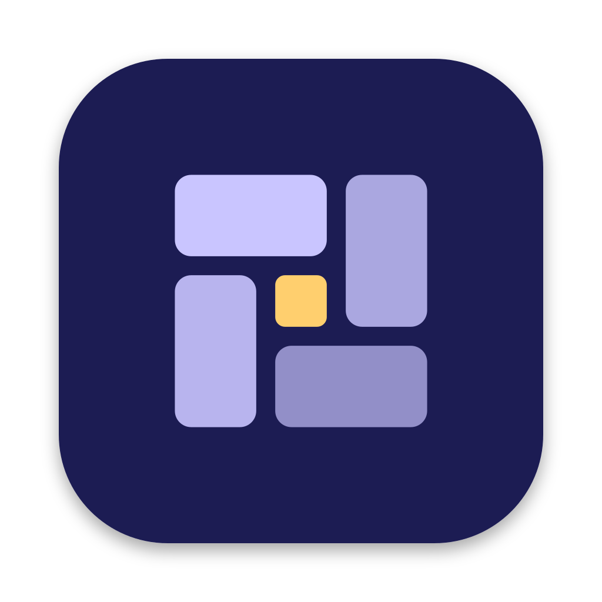
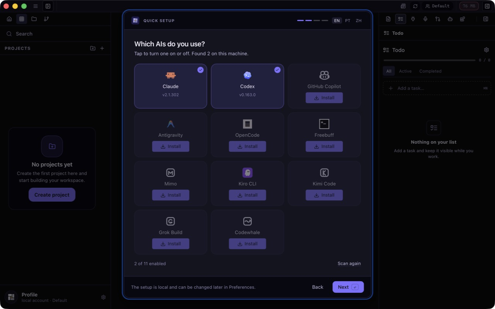
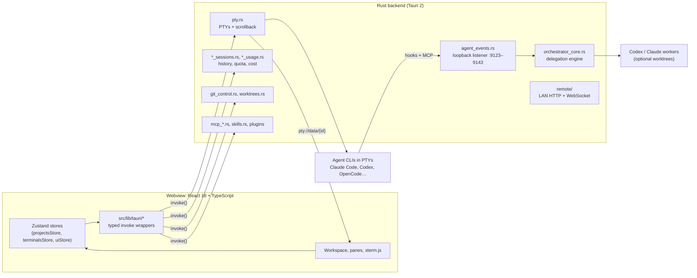

<p align="center">
  
</p>

<h1 align="center">Atrium</h1>

<p align="center">
  <strong>Every agent, shell, and project around one workspace.</strong><br />
  A macOS-first desktop app for running, organizing, and resuming coding agents side by side.
</p>

<p align="center">
  <a href="https://github.com/met0n/atrium/releases/latest"></a>
  <a href="https://github.com/met0n/atrium/actions/workflows/ci.yml"></a>
  <a href="LICENSE"></a>
  
  
</p>

<p align="center">
  <a href="https://github.com/met0n/atrium/releases/latest">Download</a> ·
  <a href="#build-from-source">Build from source</a> ·
  <a href="https://github.com/met0n/atrium/issues/new?labels=bug">Report a bug</a> ·
  <a href="https://github.com/met0n/atrium/issues/new?labels=enhancement">Request a feature</a>
</p>

<p align="center">
  
</p>

---

## What is Atrium?

Coding agents work best in parallel, but juggling a dozen terminal windows, lost sessions and
scattered quotas does not scale. Atrium is one workspace for all of it.

Every project gets real terminals (PTYs) in split panes, each with sub-tabs for Claude Code,
Codex, OpenCode, Cursor, Copilot, Antigravity, Kiro and others, or a plain shell. Layouts,
scrollback and agent conversations survive restarts. Atrium shows every provider's quota in one
place, moves a conversation from one agent to another, and lets a lead agent delegate work to
parallel workers in isolated git worktrees.

Atrium is a fork of [Alethe](https://github.com/Kc1t/alethe-agents) by Kauã Miguel, rebuilt to be
a first-class **macOS** app while staying cross-platform. See [What Atrium changes](#what-atrium-changes).

## Features

### Workspace and terminals

- **Projects and groups** with a split-pane grid per project, a layout designer, persistent tabs,
  workspace history and isolated local profiles.
- **Real PTYs** managed by the Rust backend: scrollback persisted per terminal, suspend and
  priority controls, process trees and a hard kill for stuck processes.
- **Sub-tabs per pane**, each one an agent or a shell, so related work stays together.
- **Memory controls** that show RAM per terminal and let you disable terminals or suspend groups.

### Agents

- **Supported agents:** Claude Code, Codex, OpenCode, Cursor CLI, GitHub Copilot CLI,
  Antigravity, Kiro CLI, Kimi Code, Grok Build, MiMo, Freebuff, Codewhale, plus shells (and WSL on
  Windows). Atrium detects which are installed and can install, update or remove them.
- **Session resume:** recent conversations of each working directory are listed with titles and
  reopen in one click, after a restart or a crash.
- **Handoff:** move a Claude Code conversation to Codex (and back) through a locally redacted
  context packet instead of copy-pasting the thread.
- **Usage and cost:** live quotas for Claude, Codex and Antigravity in the title bar, model
  pricing, and cost per session or transcript.

### Orchestration

- **Orchestrator MCP server:** a lead agent gets `atrium_delegate`, `atrium_check`,
  `atrium_steer`, `atrium_send`, `atrium_answer`, `atrium_diff` and friends to hand independent
  units of work to Codex or Claude workers that run in parallel, on their own token budget.
- **Isolation:** each worker can get its own git worktree, ask before leaving its sandbox, and be
  corrected mid-run without losing context.
- **Quota-aware routing:** every response carries a headroom reading so the lead prefers the
  provider with room left.
- **Standalone:** the same server ships as `atrium-orchestrator-mcp`, usable from any MCP client
  without the app open.

### Developer tools

- **Git:** status, staging, commits, a branch graph, cherry-pick and revert, push/pull, worktrees
  and GitHub pull requests.
- **MCP and skills:** scan every installed agent's MCP servers and skills, sync them across
  agents, search the MCP registry and run health checks.
- **Browser pane:** an embedded Chromium driven over the DevTools Protocol, so agents and you can
  inspect the same page.
- **Code graph:** optional Graphify knowledge graph of the repository, exposed to agents over MCP.
- **Plugins:** a sandboxed plugin system with a catalog, permissions and per-plugin storage; Git
  control, Todos and themes ship as bundled plugins.

### Everything else

- **Remote control** from your phone over the LAN or Tailscale, paired by QR code.
- **Local voice dictation** with an on-device speech model (⌘E).
- **Themes**, window icon variants, backups (export/import) and optional GitHub Gist sync.

See [`docs/FEATURES.md`](docs/FEATURES.md) for the full list.

## What Atrium changes

| Area | Alethe 1.7 | Atrium |
|---|---|---|
| Window on macOS | Borderless window, Windows-style buttons on the right | Native window with traffic lights, shadow, edge resizing, full screen and window tiling |
| Quitting with ⌘Q | Exits immediately | Confirms and saves the workspace first |
| Shortcuts on macOS | Ctrl and ⌘ both trigger app shortcuts, so shell keys like Ctrl+P/K/E/B/W/T are swallowed | App shortcuts use ⌘; every Ctrl chord reaches the terminal |
| Opening from Finder or the Dock | Agents installed with nvm, bun, volta, pnpm or vendor installers can be missed | Reads the login shell's PATH at startup |
| Codex on macOS and Linux | Orchestrator bridge and hooks point at PowerShell | `sh` + `curl` bridge and hook forwarder |
| Identity | Alethe | Own name, mark, icon and bundle id, installable next to Alethe |

The full list is in [`docs/CHANGELOG.md`](docs/CHANGELOG.md).

## Install

### Download (macOS, Apple Silicon)

1. Download `Atrium_<version>_aarch64.app.zip` from the
   [latest release](https://github.com/met0n/atrium/releases/latest) and unzip it.
2. Move **Atrium.app** to **Applications**.
3. The build is not notarized by Apple yet, so the first launch is blocked. Open it anyway from
   **System Settings ▸ Privacy & Security ▸ Open Anyway**, or clear the download flag:

   ```bash
   xattr -dr com.apple.quarantine /Applications/Atrium.app
   ```

Intel Macs, Windows and Linux: [build from source](#build-from-source) for now.

### Build from source

Requirements: Node.js 18+, Rust stable, and the Xcode Command Line Tools on macOS (Visual Studio
Build Tools on Windows, the Tauri system packages on Linux).

```sh
git clone https://github.com/met0n/atrium.git
cd atrium
npm install
npm run tauri build -- --bundles app
cp -R src-tauri/target/release/bundle/macos/Atrium.app /Applications/
```

## Using Atrium

1. On first launch, **Quick Setup** detects your installed agents and offers to install others.
2. Create a project from a folder (⌘⇧P), then open terminals in it (⌘T) and pick an agent or a
   shell for each tab.
3. Arrange panes, switch projects with ⌘1–9, and come back later: everything is restored.

### Keyboard shortcuts

On Windows and Linux, use Ctrl where macOS uses ⌘.

| Shortcut | Action |
|---|---|
| ⌘T | New terminal (agent or shell picker) |
| ⌘⌥T | New terminal with the last configuration |
| ⌘⇧T | Reopen the last closed tab |
| ⌘W | Close the focused pane |
| ⌘P | Find and jump |
| ⌘⇧P / ⌘⇧G | New project / new group |
| ⌘⇧H | Toggle Home and the workspace |
| ⌘1–9 | Open project 1–9 |
| Ctrl+Tab | Cycle recent workspace tabs |
| ⌥← / ⌥→ | Back and forward in workspace history |
| ⌘B | Toggle the left sidebar |
| ⌘⇧A | Add content to the project |
| ⌘E | Voice dictation |
| ⌘+ / ⌘− / ⌘0 | Zoom in, out, reset |
| ⌘C / ⌘V | Copy and paste in the terminal |
| Ctrl+C twice | Force-kill a stuck process |

### Terminal command

Atrium installs an `atrium` command (in `~/.local/bin` on macOS and Linux):

```bash
atrium                # open the current folder as a project
atrium ~/some/project # open the given folder
```

If the folder is already a project, Atrium brings it to the front instead of duplicating it.

## Architecture



- **Frontend → backend:** components call typed wrappers in `src/lib/tauri/`, which invoke Rust
  commands; terminal output streams back as Tauri events.
- **State:** the workspace lives in `projectsStore` and is saved per profile to `projects.json`
  with debounced atomic writes and versioned migrations.
- **Agent integration:** a token-protected loopback listener receives hooks and serves the
  orchestrator's MCP endpoint. Claude Code connects over HTTP; Codex through generated
  `.codex/config.toml` bridge scripts; OpenCode through a bridge plugin.
- **Orchestrator:** `orchestrator_core.rs` is free of Tauri, so the same engine runs inside the app
  and as the standalone `atrium-orchestrator-mcp` binary.

More in [`docs/OVERVIEW.md`](docs/OVERVIEW.md) and [`CLAUDE.md`](CLAUDE.md).

### Project layout

```text
src/                 React frontend (components, stores, lib/tauri IPC wrappers, i18n, plugins)
src-tauri/src/       Rust backend, one module per domain
src-tauri/src/bin/   atrium-orchestrator-mcp, the standalone orchestrator server
src-tauri/remote/    the phone page served by Remote Control
docs/                features, overview, plugins, themes, privacy, roadmaps, changelog
e2e/                 WebdriverIO end-to-end tests (tauri-driver, Linux and Windows)
```

## Development

```sh
npm run app            # desktop app with hot reload
npm run dev            # frontend only (no Tauri IPC)
npm run build          # typecheck, validate i18n, build the frontend
npm run lint           # eslint
npm test               # frontend unit tests (vitest)
npm run test:rust      # Rust unit tests
npm run tauri build    # release bundle → src-tauri/target/release/bundle/
```

Every user-visible string goes through `t()` with English, Portuguese (pt-BR) and Chinese
(zh-CN) translations, and every user-facing change gets a line in
[`docs/CHANGELOG.md`](docs/CHANGELOG.md). Read [`CONTRIBUTING.md`](CONTRIBUTING.md) before opening
a pull request.

## Privacy and network

“Local-first” describes workspace persistence, not an internet-free guarantee. Provider usage
polling is on by default, update checks are off until Atrium ships signed releases, and other
network features are optional or action-triggered. Manual GitHub Gist Sync is already available.

- Handing a conversation from one agent to another goes through a locally redacted context packet.
  Redaction is best effort, so review the packet before starting the target agent.
- Remote Control is off by default and uses unencrypted HTTP/WebSocket transport on the LAN, so
  enable it only on a trusted network. Clean profiles are read-only; answering agents requires a
  separate input opt-in.

See [`docs/PRIVACY.md`](docs/PRIVACY.md) for network defaults, credentials and retention.

## Roadmap

- [x] Native macOS window, ⌘Q that saves, ⌘ shortcuts that leave Ctrl to the shell
- [x] Agent CLIs found when launched from Finder or the Dock
- [x] Codex orchestration on macOS and Linux
- [ ] Signed and notarized macOS releases, with in-app updates
- [ ] Save-and-confirm when quitting from the Dock
- [ ] Orchestration runs: task DAG view, validate then merge worktrees in dependency order,
      per-run budgets (see [`docs/ROADMAP.md`](docs/ROADMAP.md))
- [ ] Intel macOS, Windows and Linux release builds

## Releases and updates

Releases are built locally for now and the in-app updater is off. To enable updates, generate a
signing key (`npx tauri signer generate`), put its public key in `src-tauri/tauri.conf.json` →
`plugins.updater.pubkey`, and build releases with `VITE_ATRIUM_UPDATER=1` and
`bundle.createUpdaterArtifacts` enabled. Cloud sync needs a GitHub OAuth app of your own: set
`ATRIUM_SYNC_GITHUB_CLIENT_ID` at build time.

## Contributors

<!-- contributors:start -->
<!-- contributors:end -->

## License and attribution

Atrium is free software under the **GNU Affero General Public License v3.0 or later**; see
[`LICENSE`](LICENSE). It is based on Alethe, Copyright (C) 2026 Kauã Miguel and Alethe
contributors; the original notices are preserved in [`NOTICE`](NOTICE). Atrium is an independent
project and is not affiliated with or endorsed by the Alethe project. See
[`TRADEMARK.md`](TRADEMARK.md).
